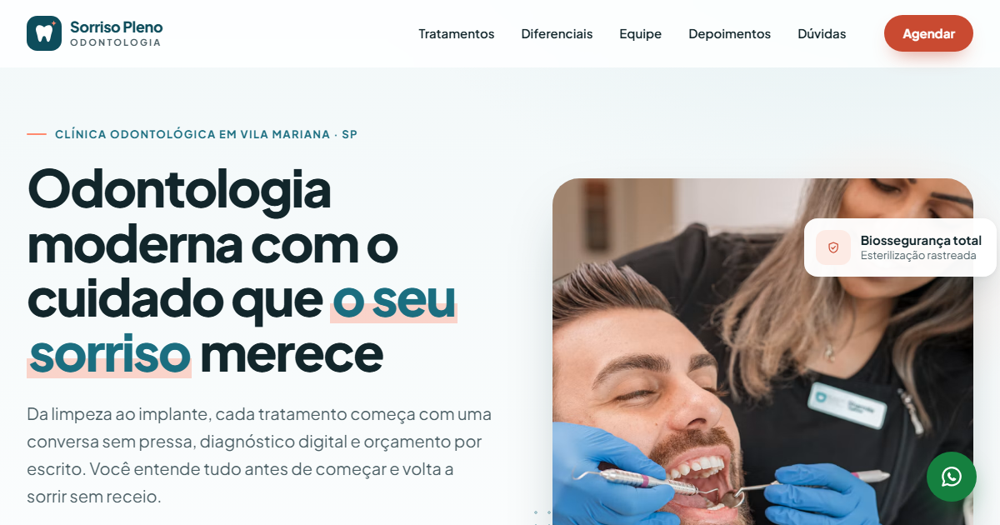

# Sorriso Pleno Odontologia — Landing page para clínica odontológica

Landing page responsiva e acessível para uma clínica odontológica fictícia, feita com HTML, CSS e JavaScript puros, com agendamento direto pelo WhatsApp.



> **Nota:** abra a página no navegador, tire um print (de preferência da primeira dobra, em tela de computador) e salve como `preview.png` na raiz do projeto para a imagem aparecer aqui.

## Funcionalidades

- **Cabeçalho fixo** que diminui e ganha sombra ao rolar, com destaque no link da seção visível.
- **Menu hambúrguer** no celular, com `aria-expanded`, fechamento por Esc, por clique fora e ao escolher um link.
- **Hero** com chamada principal, dois botões de ação, selos de confiança e cartões flutuantes sobre a foto.
- **6 tratamentos** em cards com ícones SVG próprios. O botão de cada card já deixa o tratamento selecionado no formulário.
- **Diferenciais e números** com contadores animados que só começam quando aparecem na tela.
- **Equipe** com foto, especialidade e número do CRO.
- **Carrossel de depoimentos acessível**: botões anterior/próximo, indicadores, setas do teclado, gesto de arrastar no celular e troca automática que pausa com o mouse em cima, com o foco do teclado dentro ou pelo botão de pausa.
- **FAQ** em acordeão nativo (`<details>`/`<summary>`), com abertura suave nos navegadores que suportam.
- **Formulário de agendamento** com máscara de WhatsApp `(11) 90000-0000`, validação com mensagens amigáveis embaixo de cada campo e envio de uma mensagem já formatada para o WhatsApp da clínica.
- **Botão flutuante de WhatsApp** com rótulo acessível.
- **Acessibilidade**: landmarks semânticos, link "Pular para o conteúdo", foco visível, contraste AA, textos alternativos e suporte a `prefers-reduced-motion` (sem animações para quem prefere menos movimento).
- **SEO**: `lang="pt-BR"`, meta description, Open Graph e dados estruturados (schema.org `Dentist`).
- Funciona **sem servidor**: é só abrir o `index.html`.

## Tecnologias

- HTML5 semântico
- CSS3: variáveis (custom properties), Grid, Flexbox, `clamp()` e media queries (mobile first)
- JavaScript puro (ES6+), sem bibliotecas: `IntersectionObserver`, `matchMedia`, `Intl.NumberFormat`
- Google Fonts: [Plus Jakarta Sans](https://fonts.google.com/specimen/Plus+Jakarta+Sans)
- Ícones em SVG desenhados para o projeto (sprite embutido no HTML)

Sem frameworks, sem build e sem `npm install`.

## Como rodar

1. Baixe ou clone este repositório.
2. Dê dois cliques no arquivo `index.html`. Pronto.

Se preferir um servidor local (útil para testar no celular pela mesma rede):

```bash
npx serve .
```

Depois abra o endereço que aparecer no terminal (normalmente `http://localhost:3000`).

## Como personalizar

| O que mudar | Onde |
|---|---|
| **Número do WhatsApp** | `js/script.js`, primeira linha: `const WHATSAPP = "5511900000000";` (só números: DDI + DDD + número). Todos os botões de WhatsApp e o número do rodapé usam esse valor. |
| **Nome da clínica** | `index.html` (título, meta tags, logo, rodapé e dados estruturados) e `NOME_CLINICA` em `js/script.js`. Dica: use "Localizar e substituir" por `Sorriso Pleno`. |
| **Cores** | `css/style.css`, bloco `:root` no topo: `--color-primary` (azul-petróleo), `--color-accent` (coral dos botões) e as demais. Mude ali e o site inteiro acompanha. |
| **Fonte** | Troque o link do Google Fonts no `<head>` do `index.html` e a variável `--font-sans` no `:root`. |
| **Textos e seções** | Direto no `index.html`. Cada seção está separada por um comentário (`HERO`, `TRATAMENTOS`, `EQUIPE`...). |
| **Equipe e depoimentos** | `index.html`, nos blocos marcados com `<!-- conteúdo de exemplo: troque pelos dados reais -->`. |
| **Fotos** | As imagens de exemplo vêm do [Unsplash](https://unsplash.com), de uso gratuito ([licença](https://unsplash.com/license)). Para usar as fotos da clínica, crie uma pasta `img/`, coloque suas fotos e troque o `src` de cada ``, ajustando também o `alt`. |
| **Tratamentos do formulário** | `<select id="tratamento">` no `index.html`. Se criar um card novo, use no `data-tratamento` do botão o mesmo `value` da opção. |
| **Mensagem do WhatsApp** | `MENSAGEM_PADRAO` (botões gerais) e a função `montarMensagem()` (formulário) em `js/script.js`. Um link pode ter mensagem própria com `data-msg="..."`. |
| **Endereço, telefone e horários** | Rodapé, painel da seção de agendamento e o JSON-LD no `<head>`. |
| **Tempo do carrossel** | `TEMPO_CARROSSEL` em `js/script.js` (em milissegundos). |
| **Prévia ao compartilhar** | `og:url` e `og:image` no `<head>`, depois de publicar. |

> Ao trocar a cor dos botões, confira o contraste com o texto branco (mínimo 4,5:1) no [WebAIM Contrast Checker](https://webaim.org/resources/contrastchecker/).

> Todo o conteúdo (nomes, CRO, endereço, depoimentos e números) é fictício. Se for usar para uma clínica real, siga as regras de publicidade do Conselho Federal de Odontologia (CFO), como informar nome e CRO do responsável técnico.

## Como publicar grátis no GitHub Pages

1. Crie um repositório no GitHub (por exemplo, `landing-clinica-odonto`) e envie os arquivos do projeto.
2. No repositório, vá em **Settings → Pages**.
3. Em **Build and deployment**, escolha **Source: Deploy from a branch**, selecione a branch `main` e a pasta `/ (root)` e clique em **Save**.
4. Aguarde um ou dois minutos. O site fica disponível em `https://seu-usuario.github.io/landing-clinica-odonto/`.
5. Atualize a `og:url` no `index.html` com esse endereço.

## Ideias para evoluir

Sugestões para deixar o projeto com a sua cara (e praticar):

1. **Imagens próprias e otimizadas**: troque as fotos do Unsplash por imagens em WebP/AVIF com `<picture>` e `srcset`, para carregar o tamanho certo em cada tela. Meça a diferença no Lighthouse antes e depois.
2. **Comparador "antes e depois"**: crie uma seção com duas fotos sobrepostas e um `<input type="range">` que revela uma ou outra, acessível pelo teclado. (Para uma clínica real, confira as regras do CFO sobre fotos de pacientes.)
3. **Mapa sob demanda**: adicione um botão "Ver no mapa" que só carrega o `<iframe>` do Google Maps quando clicado, mantendo a página leve, e um link "Como chegar".
4. **Modo escuro**: use `prefers-color-scheme` e um botão de alternância que salva a escolha no `localStorage`. Como as cores estão todas no `:root`, basta redefinir as variáveis.
5. **Conteúdo vindo de dados**: mova tratamentos e depoimentos para arrays de objetos no JavaScript e gere os cards com uma função. Assim, incluir um tratamento novo vira editar uma lista, não copiar HTML.
